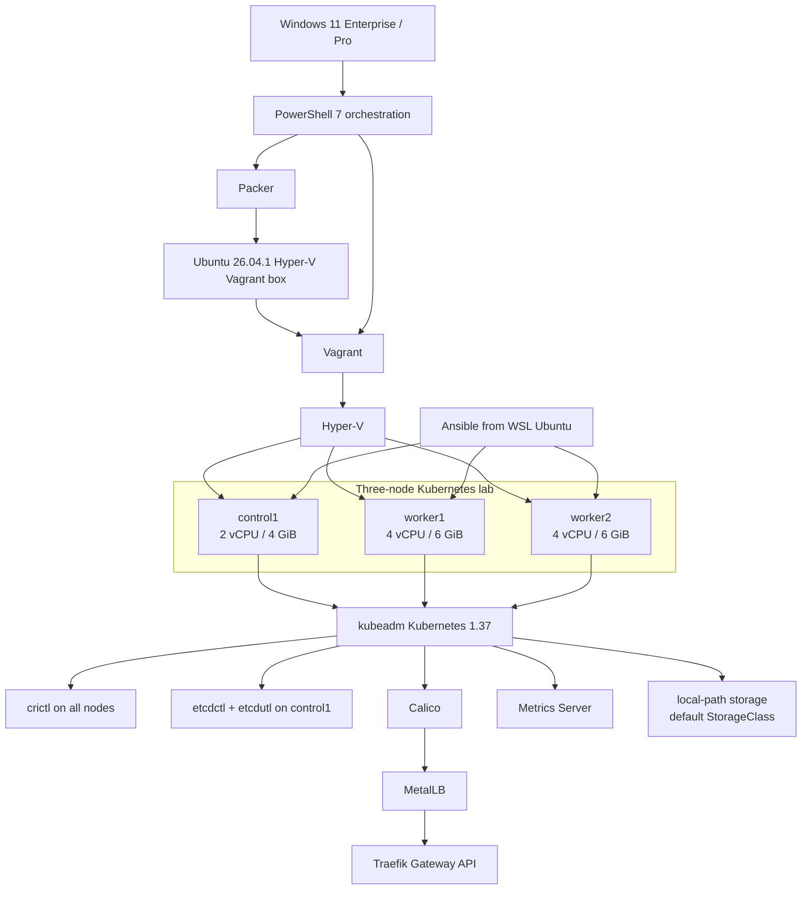

# k8s-hyperv-lab

Automated 3-node Kubernetes 1.37 lab on Windows Hyper-V with Packer, Vagrant, Ansible, kubeadm, Calico, MetalLB, Metrics Server, local-path storage, and Traefik Gateway API.

## How it works



## Architecture



## Kubernetes version

The lab targets **Kubernetes 1.37**. Kubernetes packages are installed from the dedicated `pkgs.k8s.io/core:/stable:/v1.37/deb/` repository. The automation resolves the exact Debian package build for Kubernetes **1.37.1**, installs that same package version for `kubeadm`, `kubelet`, and `kubectl`, explicitly enables `kubelet`, and then holds all three packages to keep normal OS upgrades from changing Kubernetes versions. The kubeadm configuration pins the control plane to the same version. All component versions (Kubernetes, crictl, etcd tools, Calico, MetalLB, Metrics Server, local-path-provisioner, Gateway API, Traefik, Helm) and the pod/service CIDRs are defined once in [`ansible/inventory/group_vars/all.yml`](ansible/inventory/group_vars/all.yml); change them there. The Calico pool in `kubernetes/calico/installation.yaml` must match `pod_cidr`, and the CNI playbook fails early if it does not.


### Node administration tools

The automated deployment also installs:

- `crictl` **v1.37.0** on all three nodes, configured for the containerd CRI socket.
- `etcdctl` and `etcdutl` **v3.7.3** on `control1` for etcd administration and recovery exercises.
- A preflight check that requires the nodes to use **cgroup v2**.
- A runtime assertion that containerd reports `SystemdCgroup = true`.

## VM sizing

| Node | Role | vCPU | RAM (default) |
|---|---|---:|---:|
| `control1` | Control plane | 2 | 4 GiB |
| `worker1` | Worker | 4 | 6 GiB |
| `worker2` | Worker | 4 | 6 GiB |

The default topology consumes 16 GiB of guest RAM, which leaves roughly half of a 32 GiB development laptop for Windows, WSL and tooling. Memory is fixed per VM (dynamic memory is disabled), so Hyper-V needs all of it free when the VMs boot; close memory-hungry apps first.

### Low-memory laptops

If less than about 16 GiB is free, set smaller VM sizes (in MiB) before deploying. The Vagrantfile reads these variables and rejects values below 2048:

```powershell
$env:K8S_LAB_CONTROL_MEMORY_MB = "4096"   # default 4096
$env:K8S_LAB_WORKER_MEMORY_MB  = "4096"   # default 6144 (12 GiB total with these values)
.\powershell\Deploy-K8sLab.ps1
```

Set the same values in every session that runs `vagrant up`. Changing them for existing VMs requires recreating them (`Remove-K8sLab.ps1`, then `Deploy-K8sLab.ps1`). WSL 2 can also claim up to half of your RAM while Ansible runs; cap it by creating `%UserProfile%\.wslconfig` with:

```ini
[wsl2]
memory=4GB
```

then run `wsl --shutdown` to apply it. These sizes are estimates for a lab, not measured minimums.

## Prerequisite checklist

### Windows / Hyper-V

- [ ] Windows 11 Pro, Enterprise or Education with hardware virtualization enabled
- [ ] Hyper-V feature enabled
- [ ] Hyper-V hypervisor detected
- [ ] `vmms` running
- [ ] `Get-VMHost` succeeds
- [ ] `Get-VMSwitch` succeeds
- [ ] PowerShell 7 installed
- [ ] Git installed
- [ ] Packer installed
- [ ] `oscdimg` installed (only needed to build the box locally; Packer uses it to create the autoinstall seed ISO)
- [ ] Vagrant installed
- [ ] GitHub CLI (`gh`) installed (only needed to publish or download box releases)
- [ ] `kubectl` installed
- [ ] WSL 2 installed
- [ ] Ubuntu WSL distribution installed (default name `Ubuntu-26.04`; use `Deploy-K8sLab.ps1 -WslDistribution <name>` for another)
- [ ] Ansible, Python 3 and SSH available inside WSL
- [ ] WSL 2 can reach the Hyper-V switches. `Deploy-K8sLab.ps1` enables the required IP forwarding on the `vEthernet` interfaces itself (`powershell\Enable-K8sLabWslRouting.ps1`); see [WSL must be able to reach the Hyper-V switches](docs/prerequisites.md#wsl-must-be-able-to-reach-the-hyper-v-switches) if the Ansible connectivity check still times out

Verify Hyper-V:

```powershell
DISM.exe /Online /Get-FeatureInfo /FeatureName:Microsoft-Hyper-V-All
Get-Service vmms
Get-VMHost
Get-VMSwitch
systeminfo | Select-String "hypervisor"
```

Verify required commands:

```powershell
$tools = @("git", "gh", "packer", "oscdimg", "vagrant", "kubectl", "wsl")
foreach ($tool in $tools) {
    Write-Host "`n=== $tool ===" -ForegroundColor Cyan
    Get-Command $tool -ErrorAction SilentlyContinue | Select-Object Name, Source
}
```

Verify versions:

```powershell
git --version
gh --version
packer --version
vagrant --version
kubectl version --client
wsl --version
wsl --list --verbose
```

Install commonly missing tools with WinGet:

```powershell
winget install --id Hashicorp.Packer -e
winget install --id Microsoft.OSCDIMG -e
winget install --id Hashicorp.Vagrant -e
winget install --id GitHub.cli -e
winget install --id Kubernetes.kubectl -e
```

### WSL Ubuntu

- [ ] Python 3 available
- [ ] SSH client available
- [ ] Ansible available

```bash
for tool in ansible python3 ssh; do
    printf "%-10s " "$tool"
    command -v "$tool" || echo "MISSING"
done
```

If Ansible is missing:

```bash
sudo apt update
sudo apt install -y ansible
```

See [Prerequisites](docs/prerequisites.md) for the full setup and troubleshooting guide.

## Deployment experience

Normal deployment is started from a single **elevated PowerShell 7** terminal (`pwsh`, not Windows PowerShell 5.1) on Windows, with the repository in a path that has no spaces and is not in OneDrive (see [Prerequisites](docs/prerequisites.md)). You do **not** need to enter WSL manually during deployment. `Deploy-K8sLab.ps1` invokes the configured `Ubuntu-26.04` WSL distribution and runs Ansible from there automatically.

## Quick start

1. Complete the prerequisite checklist above. Optionally run `.\powershell\Test-K8sLabReady.ps1` (elevated) to check the host.
2. Build and register the pinned Ubuntu 26.04.1 LTS box (we build our own instead of using a public registry box because HCP Vagrant is being retired; see [Why we build our own box](docs/image-build.md#why-we-build-our-own-box)):

```powershell
cd packer
packer init .
packer fmt -check -recursive .
packer validate .
packer build -force .
vagrant box add ubuntu2604-hyperv .\output\ubuntu-26.04.1-hyperv.box
cd ..
```

   The build needs an elevated session and `oscdimg` (see [Image build](docs/image-build.md#requirements-for-the-build)) and takes roughly 7 minutes once the ISO is cached. If a release already exists, you can skip the build and download the published box instead (see [GitHub validation and releases](docs/github-releases.md)). The first box built was about 2.6 GiB, over GitHub's 2 GiB per-file release limit, so a release may not exist yet.

3. Deploy the complete cluster from elevated PowerShell:

```powershell
.\powershell\Deploy-K8sLab.ps1
```

The orchestrator creates the lab network (`kube-lab-net`, 192.168.77.0/24), starts the VMs, attaches each VM's second NIC and assigns its static lab IP, discovers SSH connection details from `vagrant ssh-config`, generates the Ansible inventory, configures all nodes, initializes kubeadm, joins workers, installs Calico, MetalLB, Metrics Server, local-path storage, Gateway API CRDs and Traefik, exports kubeconfig, and validates node readiness.

Each VM has two NICs: the Hyper-V Default Switch (DHCP, used by Vagrant/SSH) and `kube-lab-net` (static `192.168.77.11-13`, used for Kubernetes). See [Networking](docs/networking.md).

To prepare the nodes only and bootstrap the cluster yourself (for kubeadm practice or a clean "pre-cluster" snapshot), add `-StopBeforeInit`. It runs everything up to and including the node tooling (OS preparation, containerd, kubeadm/kubelet/kubectl, crictl and the etcd tools) and stops before `kubeadm init`:

```powershell
.\powershell\Deploy-K8sLab.ps1 -StopBeforeInit
.\powershell\Save-K8sSnapshot.ps1 -Name pre-cluster
```

For the full order of scripts, including day-to-day start/stop, snapshots and repair, see the [Script runbook](docs/script-order.md).

## Post-deployment validation

After deployment, perform a quick health check from Windows PowerShell:

```powershell
kubectl get nodes -o wide
kubectl get pods -A
kubectl get svc -A
kubectl top nodes
kubectl get storageclass
kubectl get gatewayclass
```

Expected high-level state:

- [ ] `control1`, `worker1`, and `worker2` are `Ready`.
- [ ] Calico workloads are healthy.
- [ ] MetalLB is advertising the `192.168.77.200-220` pool.
- [ ] `kubectl top nodes` returns resource metrics.
- [ ] `local-path` is the default StorageClass; PVCs bind once a pod uses them ([Storage](docs/storage.md)).
- [ ] Traefik and the Gateway API are available.
- [ ] A Traefik `LoadBalancer` Service receives a MetalLB external IP.

For the complete layer-by-layer acceptance runbook, including north-south traffic validation, see [Post-deployment validation](docs/post-deployment-validation.md).

## CI and releases

GitHub Actions uses `ubuntu-latest` only for source validation through `.github/workflows/validate.yml` (Packer fmt/validate, yamllint, Ansible syntax, template rendering, shellcheck, Vagrantfile syntax, actionlint and PSScriptAnalyzer). The Hyper-V Vagrant box is built locally on the Windows Hyper-V host. See [GitHub validation and releases](docs/github-releases.md) for details.

Maintainers can build and publish the box in one step from the repository root (this needs write access to the repository). `-Build` drives Packer and Hyper-V, so it needs an **elevated** PowerShell 7 session; publishing an already-built box does not:

```powershell
.\powershell\Publish-K8sBoxRelease.ps1 -Build -Register   # elevated; tag auto-increments
.\powershell\Publish-K8sBoxRelease.ps1 -Build -Tag v1.2.0 # elevated; explicit tag
.\powershell\Publish-K8sBoxRelease.ps1 -Tag v1.0.0        # publish an already-built box
```

The helper requires `gh auth login`, refuses boxes of 2 GiB or more (the GitHub Releases per-file limit; the first box built from the template was 2.6 GiB, so check the size first, see [Image build](docs/image-build.md#box-size-and-github-releases)), writes `SHA256SUMS`, and creates or updates a GitHub Release containing the box and checksum. Details: [GitHub validation and releases](docs/github-releases.md).

## Documentation

- [Prerequisites](docs/prerequisites.md)
- [Script runbook (what to run, in order)](docs/script-order.md)
- [Architecture](docs/architecture.md)
- [Image build](docs/image-build.md)
- [Networking](docs/networking.md)
- [Kubernetes deployment](docs/kubernetes.md)
- [Cluster networking and traffic](docs/networking-stack.md)
- [Storage (PVCs)](docs/storage.md)
- [Snapshots](docs/snapshots.md)
- [Troubleshooting](docs/troubleshooting.md)
- [Post-deployment validation](docs/post-deployment-validation.md)
- [GitHub validation and releases](docs/github-releases.md)

## Repository layout

```text
k8s-hyperv-lab/
├── .github/workflows/validate.yml
├── ansible/
│   ├── inventory/          # group_vars/all.yml: versions and CIDRs
│   ├── playbooks/
│   └── templates/
├── docs/
│   └── images/
├── kubernetes/
│   ├── calico/
│   ├── metallb/
│   └── traefik/
├── packer/
├── powershell/
├── vagrant/
│   └── scripts/
├── .gitattributes
├── .gitignore
├── .yamllint.yml
├── LICENSE
├── PSScriptAnalyzerSettings.psd1
└── README.md
```

## Security

### Kubeconfig and bootstrap-token security

`kubeadm init` creates `admin.conf`, which grants cluster-admin access. The deployment copies this credential to the local `artifacts/kubeconfig` staging path and then to the Windows user's `~/.kube/config`. The deployment overwrites `~/.kube/config`; if that file already exists and differs, it is first backed up as `~/.kube/config.bak-<timestamp>` (merge any other cluster contexts back yourself). **Never commit, publish, or share either file.** Both locations are local credentials and are excluded by `.gitignore`.

The worker join command contains a kubeadm bootstrap token. The automation keeps the join command only in transient Ansible variables while workers are joining; it is not written to the repository.


Generated images, kubeconfigs, private keys, environment files, Vagrant state, Packer output, PowerShell transcripts and other local secrets are excluded from Git. Review `git status`, `git status --ignored`, and suspicious secret-like strings before every public release.
