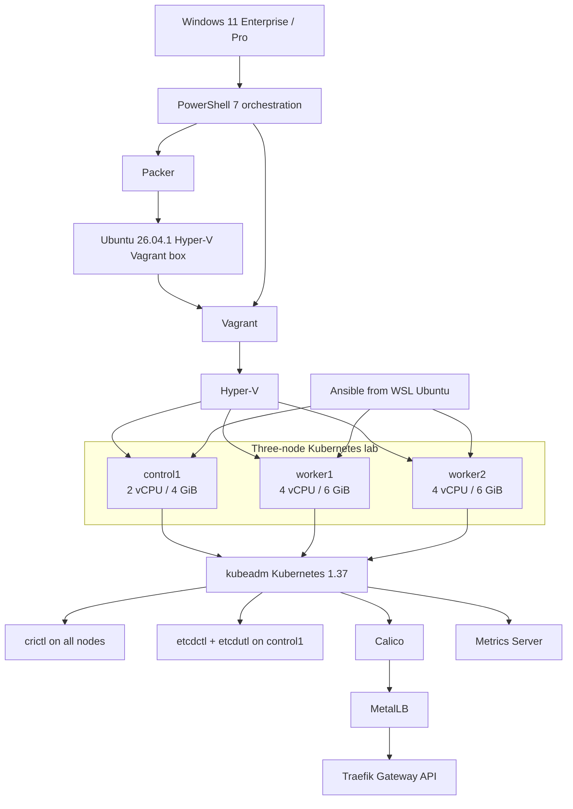

# k8s-hyperv-lab

Automated 3-node Kubernetes 1.37 lab on Windows Hyper-V with Packer, Vagrant, Ansible, kubeadm, Calico, MetalLB, Metrics Server, and Traefik Gateway API.

## Architecture



## Kubernetes version

The lab targets **Kubernetes 1.37**. Kubernetes packages are installed from the dedicated `pkgs.k8s.io/core:/stable:/v1.37/deb/` repository. The automation resolves the exact Debian package build for Kubernetes **1.37.1**, installs that same package version for `kubeadm`, `kubelet`, and `kubectl`, explicitly enables `kubelet`, and then holds all three packages to keep normal OS upgrades from changing Kubernetes versions. The kubeadm configuration currently pins the control plane to **v1.37.1**.


### Node administration tools

The automated deployment also installs:

- `crictl` **v1.37.0** on all three nodes, configured for the containerd CRI socket.
- `etcdctl` and `etcdutl` **v3.7.3** on `control1` for etcd administration and recovery exercises.
- A preflight check that requires the nodes to use **cgroup v2**.
- A runtime assertion that containerd reports `SystemdCgroup = true`.

## VM sizing

| Node | Role | vCPU | RAM |
|---|---|---:|---:|
| `control1` | Control plane | 2 | 4 GiB |
| `worker1` | Worker | 4 | 6 GiB |
| `worker2` | Worker | 4 | 6 GiB |

The default topology consumes 16 GiB of guest RAM, leaving roughly half of a 32 GiB development laptop available to Windows, WSL and tooling.

## Prerequisite checklist

### Windows / Hyper-V

- [ ] Windows 11 Pro, Enterprise or Education with hardware virtualization enabled
- [ ] Hyper-V feature enabled
- [ ] Hyper-V hypervisor detected
- [ ] `vmms` running
- [ ] `Get-VMHost` succeeds
- [ ] `Get-VMSwitch` succeeds
- [ ] PowerShell 7 installed
- [ ] Git installed
- [ ] Packer installed
- [ ] Vagrant installed
- [ ] GitHub CLI (`gh`) installed
- [ ] `kubectl` installed
- [ ] WSL 2 installed
- [ ] Ubuntu WSL distribution installed
- [ ] Ansible, Python 3 and SSH available inside WSL

Verify Hyper-V:

```powershell
DISM.exe /Online /Get-FeatureInfo /FeatureName:Microsoft-Hyper-V-All
Get-Service vmms
Get-VMHost
Get-VMSwitch
systeminfo | Select-String "hypervisor"
```

Verify required commands:

```powershell
$tools = @("git", "gh", "packer", "vagrant", "kubectl", "wsl")
foreach ($tool in $tools) {
    Write-Host "`n=== $tool ===" -ForegroundColor Cyan
    Get-Command $tool -ErrorAction SilentlyContinue | Select-Object Name, Source
}
```

Verify versions:

```powershell
git --version
gh --version
packer --version
vagrant --version
kubectl version --client
wsl --version
wsl --list --verbose
```

Install commonly missing tools with WinGet:

```powershell
winget install --id Hashicorp.Packer -e
winget install --id GitHub.cli -e
winget install --id Kubernetes.kubectl -e
```

### WSL Ubuntu

- [ ] Python 3 available
- [ ] SSH client available
- [ ] Ansible available

```bash
for tool in ansible python3 ssh; do
    printf "%-10s " "$tool"
    command -v "$tool" || echo "MISSING"
done
```

If Ansible is missing:

```bash
sudo apt update
sudo apt install -y ansible
```

See [Prerequisites](docs/prerequisites.md) for the full setup and troubleshooting guide.

## Deployment experience

Normal deployment is started from a single **elevated PowerShell 7** terminal on Windows. You do **not** need to enter WSL manually during deployment. `Deploy-K8sLab.ps1` invokes the configured `Ubuntu-26.04` WSL distribution and runs Ansible from there automatically.

## Quick start

1. Complete the prerequisite checklist above.
2. Build and register the pinned Ubuntu 26.04.1 LTS box:

```powershell
cd packer
packer init .
packer fmt -check -recursive .
packer validate .
packer build .
vagrant box add ubuntu2604-hyperv .\output\ubuntu-26.04.1-hyperv.box
cd ..
```

3. Create the lab network from elevated PowerShell:

```powershell
.\powershell\New-K8sLabNetwork.ps1
```

4. Create the VMs:

```powershell
cd vagrant
vagrant up --provider=hyperv
```

5. Deploy the complete cluster from elevated PowerShell:

```powershell
.\powershell\Deploy-K8sLab.ps1
```


```powershell
```

The orchestrator starts the VMs, discovers SSH connection details from `vagrant ssh-config`, generates the Ansible inventory, configures all nodes, initializes kubeadm, joins workers, installs Calico, MetalLB, Metrics Server, Gateway API CRDs and Traefik, exports kubeconfig, and validates node readiness.

## Post-deployment validation

After deployment, perform a quick health check from Windows PowerShell:

```powershell
kubectl get nodes -o wide
kubectl get pods -A
kubectl get svc -A
kubectl top nodes
kubectl get gatewayclass
```

Expected high-level state:

- [ ] `control1`, `worker1`, and `worker2` are `Ready`.
- [ ] Calico workloads are healthy.
- [ ] MetalLB is advertising the `192.168.77.200-220` pool.
- [ ] `kubectl top nodes` returns resource metrics.
- [ ] Traefik and the Gateway API are available.
- [ ] A Traefik `LoadBalancer` Service receives a MetalLB external IP.

For the complete layer-by-layer acceptance runbook, including north-south traffic validation, see [Post-deployment validation](docs/post-deployment-validation.md).

## CI and releases

GitHub Actions uses `ubuntu-latest` only for source validation through `.github/workflows/validate.yml`. The Hyper-V Vagrant box is built locally on the Windows Hyper-V host.

Publish a successfully built box from the repository root:

```powershell
.\powershell\Publish-K8sBoxRelease.ps1 -Tag v1.0.0
```

The helper creates `SHA256SUMS` and creates or updates a GitHub Release containing the box and checksum.

## Documentation

- [Prerequisites](docs/prerequisites.md)
- [Architecture](docs/architecture.md)
- [Image build](docs/image-build.md)
- [Networking](docs/networking.md)
- [Kubernetes deployment](docs/kubernetes.md)
- [Cluster networking and traffic](docs/networking-stack.md)
- [Snapshots](docs/snapshots.md)
- [Troubleshooting](docs/troubleshooting.md)
- [Post-deployment validation](docs/post-deployment-validation.md)
- [GitHub validation and releases](docs/github-releases.md)

## Repository layout

```text
k8s-hyperv-lab/
├── .github/workflows/validate.yml
├── ansible/
├── docs/
├── kubeadm/
├── kubernetes/
│   └── calico/
├── packer/
├── powershell/
├── vagrant/
├── .gitignore
├── LICENSE
└── README.md
```

## Security

### Kubeconfig and bootstrap-token security

`kubeadm init` creates `admin.conf`, which grants cluster-admin access. The deployment copies this credential to the local `artifacts/kubeconfig` staging path and then to the Windows user's `~/.kube/config`. **Never commit, publish, or share either file.** Both locations are local credentials and are excluded by `.gitignore`.

The worker join command contains a kubeadm bootstrap token. The automation keeps the join command only in transient Ansible variables while workers are joining; it is not written to the repository.


Generated images, kubeconfigs, private keys, environment files, Vagrant state, Packer output, PowerShell transcripts and other local secrets are excluded from Git. Review `git status`, `git status --ignored`, and suspicious secret-like strings before every public release.
