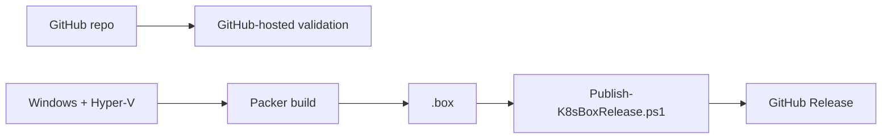

# GitHub validation and releases

GitHub-hosted `ubuntu-latest` runs source validation only (`.github/workflows/validate.yml`). The Hyper-V `.box` is built locally on the Windows Hyper-V host, because Packer's Hyper-V builder needs to start Hyper-V VMs, which hosted runners are not set up to do (no nested virtualization). Publishing is therefore run from the Hyper-V host rather than from Actions.



## What CI checks

`.github/workflows/validate.yml` runs on every pull request, every push to `main`, and manually. It validates the source only; it does not build the box, create VMs or run the playbooks:

- Packer: `init`, `fmt -check` and `validate`.
- `yamllint` on all YAML.
- `ansible-playbook --syntax-check` on every playbook.
- Renders the kubeadm Jinja template against the example inventory and lints the output.
- `shellcheck` on the scripts in `vagrant/scripts` and `packer/scripts`.
- `ruby -c` on the Vagrantfile.
- `actionlint` on the workflows.
- PSScriptAnalyzer on `powershell/` (settings in `PSScriptAnalyzerSettings.psd1`).

## Publish

Authenticate once, then run from the repository root:

```powershell
gh auth login
.\powershell\Publish-K8sBoxRelease.ps1 -Build -Register   # elevated; tag auto-increments (v1.0.0, then next patch)
.\powershell\Publish-K8sBoxRelease.ps1 -Build -Tag v1.2.0 # elevated; explicit tag
.\powershell\Publish-K8sBoxRelease.ps1 -Tag v1.0.0        # publish an already-built box (no elevation needed)
```

`-Build` needs an **elevated** PowerShell 7 session. Without `-Build`, the script publishes the box already in `packer\output` and does not need elevation.

Publishing needs write access to the repository, so it is meant for maintainers. Everyone else only needs to build the box locally ([Image build](image-build.md)) or download a published one (below).

The script checks `gh` authentication, optionally runs `packer init/fmt/validate/build -force`, refuses boxes of 2 GiB or more (the GitHub Releases per-file limit), writes `SHA256SUMS`, and creates or updates the release. Re-running with an existing tag replaces the assets. `-Register` also adds the box to Vagrant on this machine. `-Build` also needs `oscdimg` (see [Image build](image-build.md#requirements-for-the-build)).

> **Check the size first:** the first box built from this template was 2.62 GiB, over the limit, and the script stops with `Box is 2.xx GiB; GitHub Releases allows files under 2 GiB` before creating a release. The template has since been trimmed (see [Image build](image-build.md#box-size-and-github-releases)); the latest measured size is 2.32 GiB, still over the limit, and a further trim (removing the swap file) has not been built yet. The "published box" instructions below only work once a release with a box under the limit exists.

A release contains `ubuntu-26.04.1-hyperv.box` and `SHA256SUMS`.

To build without publishing, see [Image build](image-build.md).

## Using a published box instead of building

```powershell
gh release download --pattern 'ubuntu-26.04.1-hyperv.box' --pattern 'SHA256SUMS' --dir .\box-download
cd .\box-download
(Get-FileHash .\ubuntu-26.04.1-hyperv.box -Algorithm SHA256).Hash.ToLower()   # compare with SHA256SUMS
vagrant box add ubuntu2604-hyperv .\ubuntu-26.04.1-hyperv.box
```

`gh release download` fetches the latest release by default; pass a tag to pick another.
