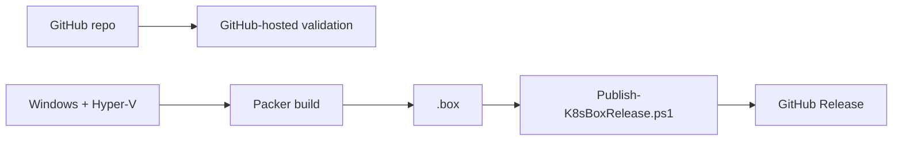

# GitHub validation and releases

GitHub-hosted `ubuntu-latest` runs source validation only. The Hyper-V `.box` is built locally on the Windows Hyper-V host.



One command (elevated PowerShell 7) builds the box with Packer and publishes it:

```powershell
gh auth login
.\powershell\Publish-K8sBoxRelease.ps1 -Build -Register          # tag auto-increments (v1.0.0, then next patch)
.\powershell\Publish-K8sBoxRelease.ps1 -Build -Tag v1.2.0        # explicit tag
```

The script checks `gh` authentication, runs `packer init/fmt/validate/build`, refuses boxes of 2 GiB or more (the GitHub Releases per-file limit), writes `SHA256SUMS`, and creates or updates the release. Re-running with an existing tag replaces the assets.

GitHub-hosted runners cannot build the box (no Hyper-V), so publishing is intentionally run from the Hyper-V host rather than from Actions.

The individual steps are below.

Build locally:

```powershell
cd packer
packer init .
packer fmt -check -recursive .
packer validate .
packer build .
```

Publish from the repository root:

```powershell
gh auth login
.\powershell\Publish-K8sBoxRelease.ps1 -Tag v1.0.0
```

A release contains `ubuntu-26.04.1-hyperv.box` and `SHA256SUMS`.

## Using a published box instead of building

```powershell
gh release download --pattern 'ubuntu-26.04.1-hyperv.box' --pattern 'SHA256SUMS' --dir .\box-download
cd .\box-download
(Get-FileHash .\ubuntu-26.04.1-hyperv.box -Algorithm SHA256).Hash.ToLower()   # compare with SHA256SUMS
vagrant box add ubuntu2604-hyperv .\ubuntu-26.04.1-hyperv.box
```

`gh release download` fetches the latest release by default; pass a tag to pick another.
