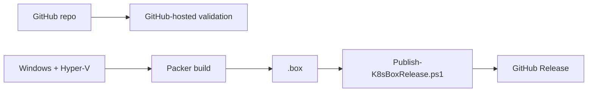

# GitHub validation and releases

GitHub-hosted `ubuntu-latest` runs source validation only. The Hyper-V `.box` is built locally on the Windows Hyper-V host.



Build locally:

```powershell
cd packer
packer init .
packer fmt -check -recursive .
packer validate .
packer build .
```

Publish from the repository root:

```powershell
gh auth login
.\powershell\Publish-K8sBoxRelease.ps1 -Tag v1.0.0
```

A release contains `ubuntu-26.04.1-hyperv.box` and `SHA256SUMS`.
