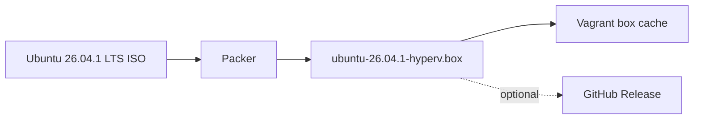

# Image build

The ISO URL and SHA-256 are pinned in the Packer template. Generated `.box` files are excluded from Git.

Build and register the box manually (elevated PowerShell 7):

```powershell
cd packer
packer init .
packer fmt -check -recursive .
packer validate .
packer build -force .
vagrant box add ubuntu2604-hyperv .\output\ubuntu-26.04.1-hyperv.box
```

`-force` overwrites a previous build in `output\`. The build needs an elevated PowerShell session.

Or build, publish to a GitHub Release and register in one step:

```powershell
.\powershell\Publish-K8sBoxRelease.ps1 -Build -Register
```

The box is built locally with Packer and hosted on GitHub Releases. It does not depend on the HCP Vagrant registry, which HashiCorp is retiring (support ended 2026-11-02; operations end 2026-12-31). GitHub Releases limits each file to 2 GiB, and the publish script refuses larger boxes.

The Packer build attaches to the Hyper-V `Default Switch` (variable `hyperv_switch_name`) for DHCP and internet during the install. The lab's static network is configured later, at deploy time; see [Networking](networking.md).
