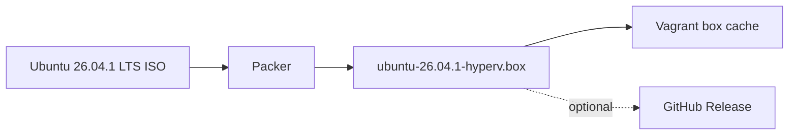

# Image build

## Why we build our own box

Most Hyper-V Vagrant labs pull a ready-made box from the public Vagrant registry (HCP Vagrant, formerly Vagrant Cloud). HashiCorp is retiring that hosted service:

| Milestone | Date |
|---|---|
| End of new box/registry creation | 2026-10-01 |
| End of support and maintenance | 2026-11-02 |
| End of operations | 2026-12-31 |

The Vagrant CLI and Packer stay available as community tools, and boxes can still be built locally. Only the hosted registry goes away, and anyone who wants to share boxes must host them elsewhere. A lab that does `config.vm.box = "someone/some-box"` therefore depends on a box that may stop downloading once the registry shuts down. I have not checked what happens to existing public box downloads after the shutdown date, so treat that as a risk, not a certainty.

This repository avoids that dependency:

- **No registry dependency.** Packer builds the box locally from the official Ubuntu ISO, and `vagrant box add` registers it from a file. Nothing is fetched from HCP Vagrant.
- **Self-hosted distribution.** Finished boxes are published to GitHub Releases with a `SHA256SUMS` file (see [GitHub validation and releases](github-releases.md)), which is the customer-hosted option HashiCorp points to.
- **Pinned and verifiable.** The ISO URL and SHA-256 are pinned in the Packer template, so every build starts from a known Ubuntu 26.04.1 LTS image.
- **Fits the lab.** Generation 2 VM with Secure Boot, our own user setup, and a base image containing only what Vagrant needs. Kubernetes is configured later by Ansible.

Source: HashiCorp's HCP Vagrant deprecation notice.

## Build steps


Generated `.box` files are excluded from Git.

Build and register the box manually (elevated PowerShell 7):

```powershell
cd packer
packer init .
packer fmt -check -recursive .
packer validate .
packer build -force .
vagrant box add ubuntu2604-hyperv .\output\ubuntu-26.04.1-hyperv.box
```

`-force` overwrites a previous build in `output\`. The build needs an elevated PowerShell session.

Maintainers can instead build, publish to a GitHub Release and register in one step (needs `gh auth login` and write access to the repository):

```powershell
.\powershell\Publish-K8sBoxRelease.ps1 -Build -Register
```

GitHub Releases limits each file to 2 GiB, and the publish script refuses larger boxes.

The Packer build attaches to the Hyper-V `Default Switch` (variable `hyperv_switch_name`) for DHCP and internet during the install. The lab's static network is configured later, at deploy time; see [Networking](networking.md).

## Requirements for the build

- An **elevated PowerShell 7** session with Hyper-V enabled.
- `packer` and `oscdimg` on `PATH` (`winget install --id Hashicorp.Packer -e` and `winget install --id Microsoft.OSCDIMG -e`). Packer builds the autoinstall seed ISO (`user-data`, `meta-data`, volume label `cidata`) with an external tool, and `oscdimg` is the one it can use on Windows. Without it the build stops after about 30 seconds with `could not find a supported CD ISO creation command`. Open a new terminal after installing so `PATH` updates.
- The repository in a path without spaces and outside OneDrive (see [Prerequisites](prerequisites.md)).

A successful build takes roughly 7 minutes once the ISO is cached in `packer\packer_cache`.

## What the autoinstall configures

`packer/autoinstall/user-data` installs Ubuntu unattended and sets two things that the build depends on:

- **`linux-cloud-tools-virtual`** (in `packages`): provides the Hyper-V KVP daemon. Packer's `hyperv-iso` builder, and later Vagrant, learn the guest IP through Hyper-V integration services. Without the daemon the VM boots and runs SSH but Hyper-V never reports an IP, and `packer build` waits at `Waiting for SSH to become available...` until the 60-minute timeout.
- **An explicit `network:` block** that enables DHCP on any NIC named `e*`. The installer boots with `net.ifnames=0` (see `boot_command` in `ubuntu-26.04.pkr.hcl`) but the installed system does not, so a generated config for `eth0` can miss the NIC after the first reboot. This catch-all rule also matches the second NIC added at deploy time; see [Networking](networking.md) for how the static lab address takes precedence.

## Box size and GitHub Releases

GitHub Releases allows files under 2 GiB, and `Publish-K8sBoxRelease.ps1` refuses anything larger. The first build from this template was **2.62 GiB** (2,815,494,777 bytes), over the limit.

To shrink it, `scripts/setup.sh` now runs `apt-get autoremove --purge` (the installer leaves an older kernel, headers, ZFS modules and tools that `apt` reports as "no longer required"), deletes the apt package lists, and the `vagrant` post-processor uses `compression_level = 9`. **I have not rebuilt with these changes, so the new size is unmeasured and may still be over 2 GiB.** After a rebuild, check it:

```powershell
(Get-Item .\packer\output\ubuntu-26.04.1-hyperv.box).Length / 1GB
```

If it is still 2 GiB or more, host the box somewhere other than GitHub Releases (the local build is unaffected) or slim the image further. See [GitHub validation and releases](github-releases.md).

## Troubleshooting the build

| Symptom | Likely cause |
|---|---|
| `could not find a supported CD ISO creation command` | `oscdimg` is not installed or not on `PATH`. |
| Stuck at `Waiting for SSH to become available...` | Guest has no IP or does not report it. Check that `linux-cloud-tools-virtual` is in `user-data`, open the VM console in Hyper-V Manager and look at `ip -br a`. |
| `vagrant box add` fails with `bad URI(is not URI?)` | The path contains spaces (for example under `OneDrive - Company`). Use a path without spaces. |
| `vagrant box add` says `Couldn't open file ...` | The `.box` is not at that path; the build did not finish or the repository was moved. |
