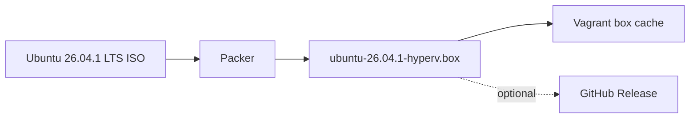

# Image build

## Why we build our own box

Most Hyper-V Vagrant labs pull a ready-made box from the public Vagrant registry (HCP Vagrant, formerly Vagrant Cloud). HashiCorp is retiring that hosted service:

| Milestone | Date |
|---|---|
| End of new box/registry creation | 2026-10-01 |
| End of support and maintenance | 2026-11-02 |
| End of operations | 2026-12-31 |

The Vagrant CLI and Packer stay available as community tools, and boxes can still be built locally. Only the hosted registry goes away, and anyone who wants to share boxes must host them elsewhere. A lab that does `config.vm.box = "someone/some-box"` therefore depends on a box that may stop downloading once the registry shuts down. I have not checked what happens to existing public box downloads after the shutdown date, so treat that as a risk, not a certainty.

This repository avoids that dependency:

- **No registry dependency.** Packer builds the box locally from the official Ubuntu ISO, and `vagrant box add` registers it from a file. Nothing is fetched from HCP Vagrant.
- **Self-hosted distribution.** Finished boxes are published to GitHub Releases with a `SHA256SUMS` file (see [GitHub validation and releases](github-releases.md)), which is the customer-hosted option HashiCorp points to.
- **Pinned and verifiable.** The ISO URL and SHA-256 are pinned in the Packer template, so every build starts from a known Ubuntu 26.04.1 LTS image.
- **Fits the lab.** Generation 2 VM with Secure Boot, our own user setup, and a base image containing only what Vagrant needs. Kubernetes is configured later by Ansible.

Source: HashiCorp's HCP Vagrant deprecation notice.

## Build steps

The ISO URL and SHA-256 are pinned in the Packer template. Generated `.box` files are excluded from Git.

Build and register the box manually (elevated PowerShell 7):

```powershell
cd packer
packer init .
packer fmt -check -recursive .
packer validate .
packer build -force .
vagrant box add ubuntu2604-hyperv .\output\ubuntu-26.04.1-hyperv.box
```

`-force` overwrites a previous build in `output\`. The build needs an elevated PowerShell session.

Or build, publish to a GitHub Release and register in one step:

```powershell
.\powershell\Publish-K8sBoxRelease.ps1 -Build -Register
```

GitHub Releases limits each file to 2 GiB, and the publish script refuses larger boxes.

The Packer build attaches to the Hyper-V `Default Switch` (variable `hyperv_switch_name`) for DHCP and internet during the install. The lab's static network is configured later, at deploy time; see [Networking](networking.md).
