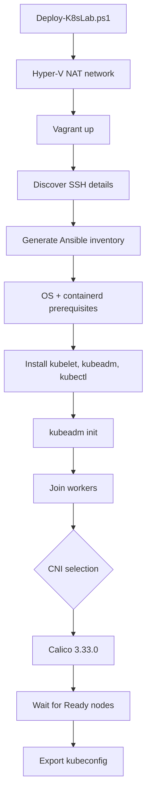

# Automated Kubernetes deployment



Run from elevated PowerShell:

```powershell
.\powershell\Deploy-K8sLab.ps1
```

The generated `ansible/inventory/hosts.yml` is local state and is ignored by Git. The committed `hosts.example.yml` documents the topology.

## Version and upgrade policy

The lab targets Kubernetes **1.37.1**, set once as `kubernetes_version` in `ansible/inventory/group_vars/all.yml` (the apt repository minor and the kubeadm `kubernetesVersion` are derived from it). The package playbook selects the exact `1.37.1-*` Debian package build exposed by the v1.37 `pkgs.k8s.io` repository, installs it consistently for `kubeadm`, `kubelet`, and `kubectl`, enables the kubelet service, and places all three packages on hold. Kubernetes upgrades must be performed deliberately with the kubeadm upgrade workflow rather than through an ordinary Ubuntu upgrade.

## Node identity preflight

Before Kubernetes configuration, `preflight.yml` verifies that the three VMs have unique hostnames, DMI product UUIDs, and primary MAC addresses. Deployment stops if any identity collision is detected.

## Administrative credentials

The exported kubeconfig contains cluster-admin credentials. It is local state, ignored by Git, and must not be published or shared. kubeadm join bootstrap tokens are transient and are not persisted in repository files.

## Runtime and etcd troubleshooting tools

`crictl` v1.37.0 is installed on every Kubernetes node and configured through `/etc/crictl.yaml` to use `unix:///run/containerd/containerd.sock` for both runtime and image operations. This supports node-level troubleshooting below the `kubectl` layer.

`control1` also receives `etcdctl` and `etcdutl` v3.7.3. `etcdctl` is intended for network operations against the running etcd API; `etcdutl` is intended for offline administration/recovery tasks. Installing these clients does not replace kubeadm's management of the stacked etcd static Pod.

## cgroup policy

The preflight requires `stat -fc %T /sys/fs/cgroup` to return `cgroup2fs`. After containerd configuration, the deployment also validates `SystemdCgroup = true` in the active containerd configuration. Deployment stops if either condition is not satisfied.
