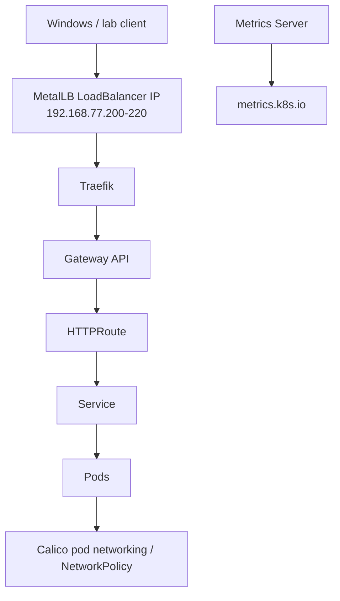

# Cluster networking and traffic

## Components

- **Calico 3.33.0**: CNI, pod networking and NetworkPolicy.
- **MetalLB 0.16.2**: L2 LoadBalancer IP allocation/advertisement from `192.168.77.200-220`.
- **Metrics Server 0.9.1**: resource metrics for `kubectl top` and CPU/memory HPA use cases.
- **Gateway API 1.6.3 Standard CRDs**: API contract used by Traefik.
- **Traefik Helm chart 42.3.1 / Traefik Proxy 3.7.17**: north-south Gateway API controller.

The pinned versions live in `ansible/inventory/group_vars/all.yml` (the Traefik Proxy version is the one shipped by the pinned chart). The numbers above describe the current pins; update them when you bump that file.

The Metrics Server lab configuration uses `--kubelet-insecure-tls` because local kubeadm kubelet certificates may not be suitable for Metrics Server verification. This reduces security and is only appropriate for this disposable lab.
