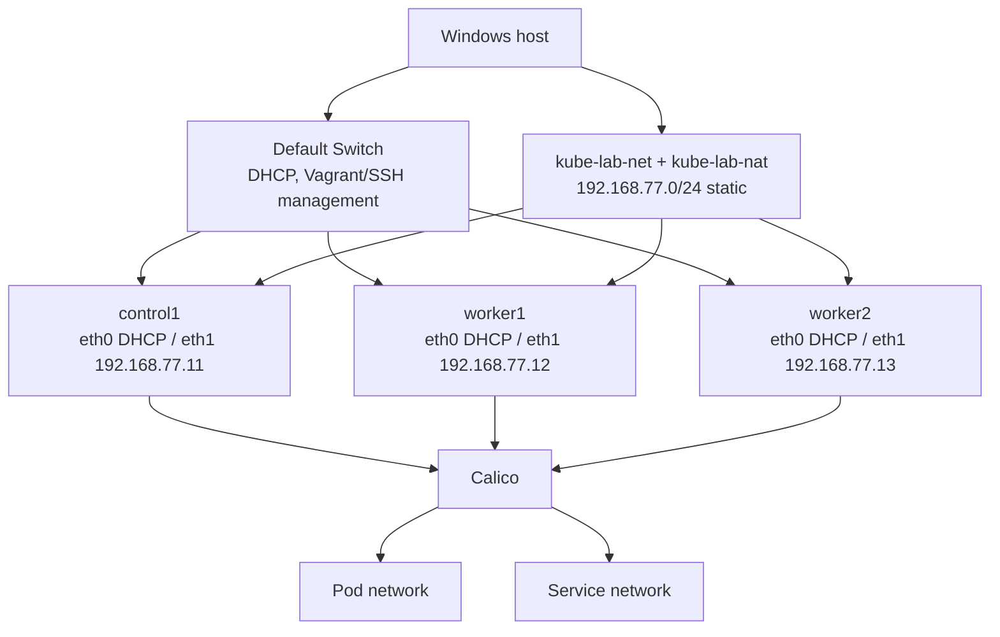

# Networking

Each VM has two NICs:

| NIC | Switch | Addressing | Purpose |
|---|---|---|---|
| first (`eth0`) | Hyper-V Default Switch | DHCP | Vagrant discovers the guest IP and Ansible connects over SSH. Override the switch with `K8S_LAB_MGMT_SWITCH`. |
| second (`eth1`) | `kube-lab-net` (internal, NAT) | static `192.168.77.11-13/24` | Kubernetes node IPs, API endpoint, MetalLB pool, kubeconfig access from Windows. |

The Vagrant Hyper-V provider cannot assign static IPs, so `Deploy-K8sLab.ps1` does it in two steps after `vagrant up`:

1. `powershell/Add-K8sLabNic.ps1` hot-adds the `kube-lab` NIC on `kube-lab-net` to each VM.
2. `vagrant provision --provision-with lab-net` runs `vagrant/scripts/configure-lab-nic.sh`, which writes a netplan file matching the NIC by MAC address.

If the lab NICs get disconnected or the switch is recreated, run `powershell/Repair-K8sLabNetwork.ps1`.

Host networking and Kubernetes networking are separate troubleshooting layers.
