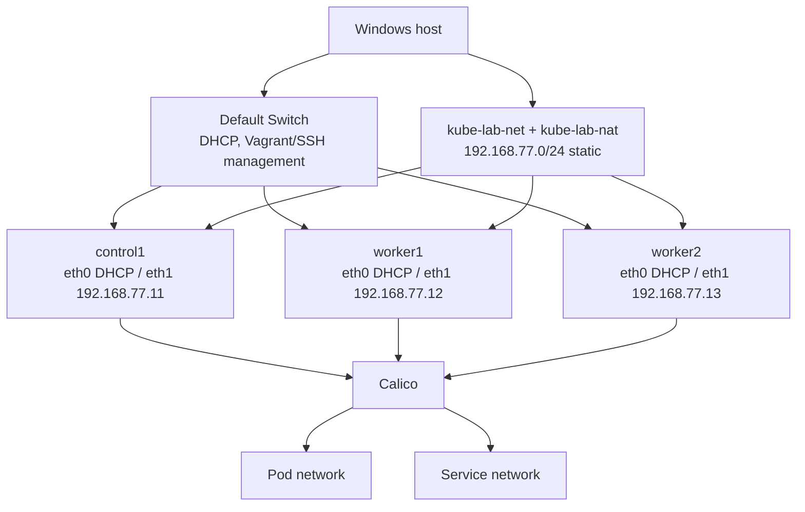

# Networking

Each VM has two NICs:

| NIC | Switch | Addressing | Purpose |
|---|---|---|---|
| first (`eth0`) | Hyper-V Default Switch | DHCP | Vagrant discovers the guest IP and Ansible connects over SSH. Override the switch with `K8S_LAB_MGMT_SWITCH`. |
| second (`eth1`) | `kube-lab-net` (internal, NAT) | static `192.168.77.11-13/24` | Kubernetes node IPs, API endpoint, MetalLB pool, kubeconfig access from Windows. |

The Vagrant Hyper-V provider cannot assign static IPs, so `Deploy-K8sLab.ps1` does it in two steps after `vagrant up`:

1. `powershell/Add-K8sLabNic.ps1` hot-adds the `kube-lab` NIC on `kube-lab-net` to each VM.
2. `vagrant provision --provision-with lab-net` runs `vagrant/scripts/configure-lab-nic.sh`, which writes `/etc/netplan/60-k8s-lab.yaml` matching the NIC by MAC address.

Two details of that script matter:

- **The netplan id is `a0-k8slab` on purpose.** The box ships a catch-all DHCP rule (id `all-en`, matching `e*`, from the Packer autoinstall) that also matches the second NIC. systemd-networkd applies only the first matching file in name order, so the lab config must sort before `all-en`; otherwise the NIC stays on DHCP, `kube-lab-net` has no DHCP server, and the static address is never applied (`Failed to configure 192.168.77.x`).
- **It is idempotent.** If the lab IP is already present it exits without running `netplan apply`, which restarts networking and can drop the SSH session Vagrant is using. `Deploy-K8sLab.ps1` also retries this step up to three times.

### Reaching the VMs from WSL

Ansible runs in WSL 2 and connects to each VM over the **Default Switch** address (`eth0`, `172.24.x.x`; these addresses change between boots and the inventory is regenerated on every deploy). WSL 2 uses a separate NAT network, and Windows does not forward packets between the WSL, Default Switch and `kube-lab-net` interfaces unless IP forwarding is enabled on them. See [Prerequisites](prerequisites.md#wsl-must-be-able-to-reach-the-hyper-v-switches) for the command and [Troubleshooting](troubleshooting.md).

Environment variables read by the Vagrantfile: `K8S_LAB_MGMT_SWITCH` (management switch, default `Default Switch`), `K8S_LAB_BOX` (box name, default `ubuntu2604-hyperv`), and `K8S_LAB_CONTROL_MEMORY_MB` / `K8S_LAB_WORKER_MEMORY_MB` (VM memory in MiB, defaults 4096 and 6144).

If the lab NICs get disconnected or the switch is recreated, run `powershell/Repair-K8sLabNetwork.ps1`.

Host networking and Kubernetes networking are separate troubleshooting layers.
