# Script runbook: what to run, and in what order

Run everything from the repository root in an **elevated PowerShell 7** session (except where noted).

## First-time setup

| Step | Script | What it does |
|---|---|---|
| 1 | `.\powershell\Test-K8sLabReady.ps1` | Host preflight: `vmms` running and required tools installed (`git`, `packer`, `vagrant`, `kubectl`, `wsl`). Exits 1 if any fail. A missing `gh`, `oscdimg` or `kube-lab-net` switch only produces a warning (`gh` is needed just for box releases, `oscdimg` just for building the box locally, and `Deploy-K8sLab.ps1` creates the switch). It does not check the cluster or WSL's network access to the VMs. |
| 2 | Get the box: `packer build -force .` then `vagrant box add ubuntu2604-hyperv ...`, or `gh release download` | Build the Ubuntu 26.04.1 box locally (commands in [Image build](image-build.md)), or download a published one ([GitHub validation and releases](github-releases.md)), then register it with Vagrant. No GitHub access is needed to build. |
| 2b (optional) | `.\powershell\Publish-K8sBoxRelease.ps1 -Build -Register` | Maintainers only: builds the box, publishes it to a GitHub Release (needs `gh auth login` and write access to the repository) and registers it with Vagrant. |
| 3 | `.\powershell\Deploy-K8sLab.ps1` | Does everything else in order (below). Add `-StopBeforeInit` to stop before `kubeadm init`. |
| 4 | `kubectl get nodes -o wide` | Confirm all three nodes are `Ready`. Full checks: [Post-deployment validation](post-deployment-validation.md). |

### What `Deploy-K8sLab.ps1` runs for you

You do not run these yourself, but this is the order they execute in:

1. `New-K8sLabNetwork.ps1`: creates the `kube-lab-net` switch and NAT (with a subnet-collision preflight).
2. `vagrant up --provider=hyperv`: creates the three VMs on the Default Switch.
3. `Add-K8sLabNic.ps1`: adds the second NIC on `kube-lab-net`.
4. `vagrant provision --provision-with lab-net`: assigns the static `192.168.77.x` addresses (idempotent; retried up to three times).
5. `Enable-K8sLabWslRouting.ps1`: starts the WSL distribution and enables IP forwarding on the WSL, Default Switch and `kube-lab-net` interfaces so Ansible in WSL can reach the VMs (idempotent).
6. `New-K8sAnsibleInventory.ps1`: builds the Ansible inventory from `vagrant ssh-config` and copies each node's SSH key into WSL with mode 600.
7. An Ansible connectivity check from WSL (`ansible all -m ping`). If this times out, WSL still cannot reach the Hyper-V switches; see [Prerequisites](prerequisites.md#wsl-must-be-able-to-reach-the-hyper-v-switches). Then the Ansible playbooks, in this order: `preflight`, `prerequisites`, `kubernetes-packages`, `install-node-tools`, `bootstrap-cluster`, `install-cni`, `install-metallb`, `install-metrics-server`, `install-local-path`, `install-traefik`, `validate-cluster`.
8. Copies the kubeconfig to `~/.kube/config`.

## Day to day

| Task | Script |
|---|---|
| Shut the lab down | `.\powershell\Stop-K8sLab.ps1` |
| Start it again | `.\powershell\Start-K8sLab.ps1` |
| See VM state, CPU, memory, uptime | `.\powershell\Get-K8sLabStatus.ps1` |
| Take a checkpoint of all three VMs | `.\powershell\Save-K8sSnapshot.ps1 -Name post-deploy` |
| List checkpoints | `.\powershell\Get-K8sSnapshot.ps1` |
| Roll all three VMs back | `.\powershell\Restore-K8sSnapshot.ps1 -Name post-deploy` |
| Delete a checkpoint | `.\powershell\Remove-K8sSnapshot.ps1 -Name post-deploy` |
| Fix a missing lab NIC or switch | `.\powershell\Repair-K8sLabNetwork.ps1` (then `cd vagrant; vagrant provision --provision-with lab-net`) |
| Destroy the VMs | `.\powershell\Remove-K8sLab.ps1` |
| Rebuild from scratch | `Remove-K8sLab.ps1`, then `Deploy-K8sLab.ps1` |

Good checkpoints to keep: `pre-cluster` (taken after `Deploy-K8sLab.ps1 -StopBeforeInit`) and `post-deploy` (taken after a full deploy). `Save-K8sSnapshot.ps1` requires exactly three lab VMs.

## Which scripts need elevation

All scripts in `powershell\` need an elevated session except `Publish-K8sBoxRelease.ps1` (only with `-Build`) and `New-K8sAnsibleInventory.ps1`.
