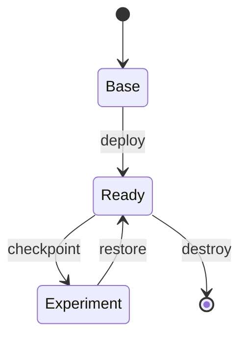

# Snapshots

Checkpoint helpers treat the three VMs as a lab state.

```powershell
.\powershell\Save-K8sSnapshot.ps1 -Name post-deploy      # checkpoint all three VMs
.\powershell\Get-K8sSnapshot.ps1                          # list checkpoints
.\powershell\Restore-K8sSnapshot.ps1 -Name post-deploy    # roll all three VMs back
.\powershell\Remove-K8sSnapshot.ps1 -Name post-deploy     # delete a checkpoint
```

`-Name` is required. The Vagrantfile disables Hyper-V's automatic checkpoints so only the ones you create appear. See the [Script runbook](script-order.md) for where snapshots fit in the workflow.
