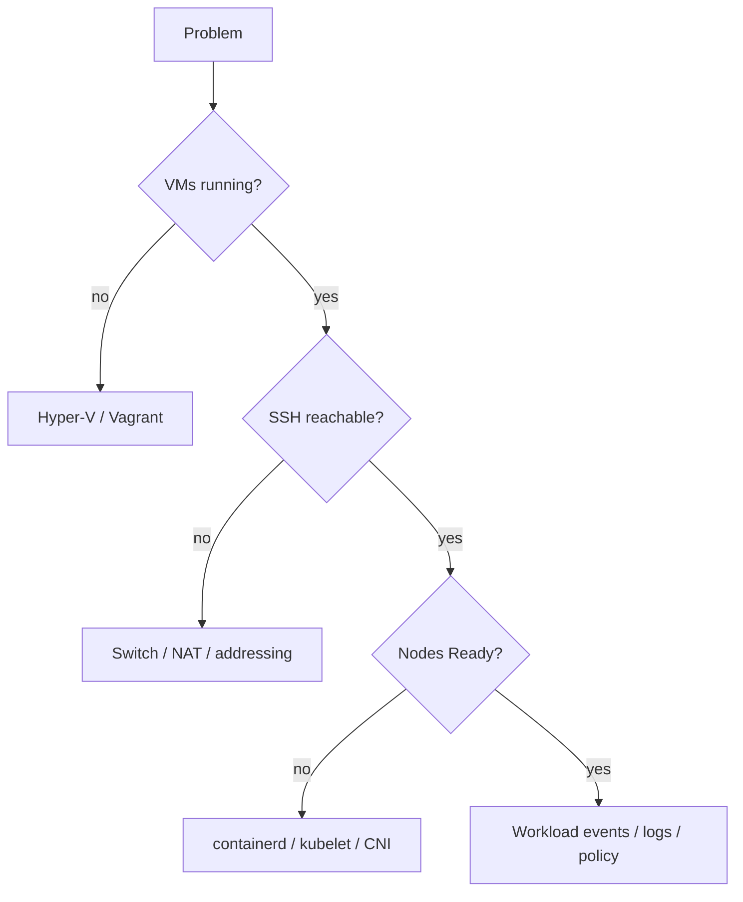

# Troubleshooting

## Missing Windows tools

Use `Get-Command <tool>` first. For commonly missing tools:

```powershell
winget install --id Hashicorp.Packer -e
winget install --id Hashicorp.Vagrant -e
winget install --id GitHub.cli -e
winget install --id Kubernetes.kubectl -e
```

Close and reopen the terminal after installation so PATH changes are reloaded.

## Missing Ansible

Inside WSL Ubuntu:

```bash
sudo apt update
sudo apt install -y ansible
```

## Hyper-V optional-feature cmdlet failure

If PowerShell 7 reports `Class not registered`, verify with:

```powershell
DISM.exe /Online /Get-FeatureInfo /FeatureName:Microsoft-Hyper-V-All
Get-Service vmms
Get-VMHost
```

## VMs unreachable, or a node has no 192.168.77.x address

Each VM has two NICs: the Default Switch (DHCP, used by Vagrant/SSH) and `kube-lab-net` (static lab IP). If a node is missing its lab address, or the switch was recreated, re-attach the NICs and re-apply the static IPs:

```powershell
.\powershell\Repair-K8sLabNetwork.ps1
cd vagrant
vagrant provision --provision-with lab-net
```

If `New-K8sLabNetwork.ps1` reports that `192.168.77.0/24` is already routed through another interface or NAT, another tool (Docker, WSL, a VPN or another lab) owns the subnet. Remove it or change the prefix.

## Ansible cannot connect: `UNPROTECTED PRIVATE KEY FILE`

Files under `/mnt/c` look world-readable inside WSL, and `ssh` refuses such keys. `New-K8sAnsibleInventory.ps1` therefore copies each node's Vagrant key into the WSL distribution at `~/.ssh/k8s-lab/<node>` with mode 600 and points the inventory at the copy. If you see this error, regenerate the inventory (re-run `Deploy-K8sLab.ps1`) rather than pointing Ansible at a key on the Windows drive.

## `vagrant up` asks for a Windows username and password

That is Vagrant's default SMB synced folder. The Vagrantfile disables it (`synced_folder ".", "/vagrant", disabled: true`); if you see the prompt, check that the line is still present.

## Box check fails or the box is missing

`Deploy-K8sLab.ps1` requires the `ubuntu2604-hyperv` box. Build it with `.\powershell\Publish-K8sBoxRelease.ps1 -Build -Register` or follow [Image build](image-build.md). To use a box registered under another name, set `K8S_LAB_BOX` (read by the Vagrantfile) and skip the name check:

```powershell
$env:K8S_LAB_BOX = 'my-box-name'
.\powershell\Deploy-K8sLab.ps1 -SkipBoxCheck
```

## Package or download failures during deployment

The playbooks retry apt and download tasks five times. If a task still fails, check internet access from the nodes (`vagrant ssh control1`, then `curl -I https://pkgs.k8s.io`) and re-run `Deploy-K8sLab.ps1`; the playbooks are safe to re-run.

## Layered diagnosis


