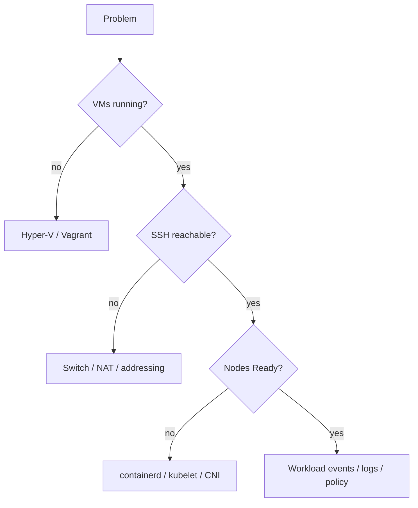

# Troubleshooting

## Missing Windows tools

Use `Get-Command <tool>` first. For commonly missing tools:

```powershell
winget install --id Hashicorp.Packer -e
winget install --id GitHub.cli -e
winget install --id Kubernetes.kubectl -e
```

Close and reopen the terminal after installation so PATH changes are reloaded.

## Missing Ansible

Inside WSL Ubuntu:

```bash
sudo apt update
sudo apt install -y ansible
```

## Hyper-V optional-feature cmdlet failure

If PowerShell 7 reports `Class not registered`, verify with:

```powershell
DISM.exe /Online /Get-FeatureInfo /FeatureName:Microsoft-Hyper-V-All
Get-Service vmms
Get-VMHost
```

## Layered diagnosis


