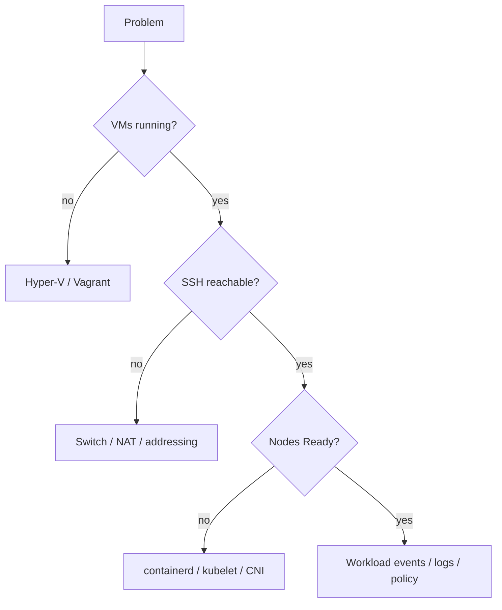

# Troubleshooting

## Missing Windows tools

Use `Get-Command <tool>` first. For commonly missing tools:

```powershell
winget install --id Hashicorp.Packer -e
winget install --id Microsoft.OSCDIMG -e
winget install --id Hashicorp.Vagrant -e
winget install --id GitHub.cli -e
winget install --id Kubernetes.kubectl -e
```

Close and reopen the terminal after installation so PATH changes are reloaded.

## Missing Ansible

Inside WSL Ubuntu:

```bash
sudo apt update
sudo apt install -y ansible
```

## Hyper-V optional-feature cmdlet failure

If PowerShell 7 reports `Class not registered`, verify with:

```powershell
DISM.exe /Online /Get-FeatureInfo /FeatureName:Microsoft-Hyper-V-All
Get-Service vmms
Get-VMHost
```

## VMs unreachable, or a node has no 192.168.77.x address

Each VM has two NICs: the Default Switch (DHCP, used by Vagrant/SSH) and `kube-lab-net` (static lab IP). If a node is missing its lab address, or the switch was recreated, re-attach the NICs and re-apply the static IPs:

```powershell
.\powershell\Repair-K8sLabNetwork.ps1
cd vagrant
vagrant provision --provision-with lab-net
```

If `New-K8sLabNetwork.ps1` reports that `192.168.77.0/24` is already routed through another interface or NAT, another tool (Docker, WSL, a VPN or another lab) owns the subnet. Remove it or change the prefix.

## Ansible cannot connect: `UNPROTECTED PRIVATE KEY FILE`

Files under `/mnt/c` look world-readable inside WSL, and `ssh` refuses such keys. `New-K8sAnsibleInventory.ps1` therefore copies each node's Vagrant key into the WSL distribution at `~/.ssh/k8s-lab/<node>` with mode 600 and points the inventory at the copy. If you see this error, regenerate the inventory (re-run `Deploy-K8sLab.ps1`) rather than pointing Ansible at a key on the Windows drive.

## `vagrant up` asks for a Windows username and password

That is Vagrant's default SMB synced folder. The Vagrantfile disables it (`synced_folder ".", "/vagrant", disabled: true`); if you see the prompt, check that the line is still present.

## Box check fails or the box is missing

`Deploy-K8sLab.ps1` requires the `ubuntu2604-hyperv` box. Build it with `.\powershell\Publish-K8sBoxRelease.ps1 -Build -Register` or follow [Image build](image-build.md). To use a box registered under another name, set `K8S_LAB_BOX` (read by the Vagrantfile) and skip the name check:

```powershell
$env:K8S_LAB_BOX = 'my-box-name'
.\powershell\Deploy-K8sLab.ps1 -SkipBoxCheck
```

## Package or download failures during deployment

The playbooks retry apt and download tasks five times. If a task still fails, check internet access from the nodes (`vagrant ssh control1`, then `curl -I https://pkgs.k8s.io`) and re-run `Deploy-K8sLab.ps1`; the playbooks are safe to re-run.

## `Deploy-K8sLab.ps1` is blocked: "not digitally signed" or a security warning

You are probably in Windows PowerShell 5.1 (`powershell.exe`). Open an elevated **PowerShell 7** window (`pwsh`) instead. If PowerShell 7 shows a "Security warning: Run only scripts that you trust" prompt, run `Get-ChildItem -Recurse -Filter *.ps1 | Unblock-File` once. See [Prerequisites](prerequisites.md#powershell-7-and-script-execution).

## `packer build` fails with `could not find a supported CD ISO creation command`

Install `oscdimg` (`winget install --id Microsoft.OSCDIMG -e`) and open a new terminal. See [Image build](image-build.md#requirements-for-the-build).

## `packer build` waits at `Waiting for SSH to become available...`

Hyper-V never learned the guest IP, or the installed system has no network. The autoinstall installs `linux-cloud-tools-virtual` (Hyper-V KVP daemon) and sets DHCP on `e*` NICs to prevent this; if you changed `packer/autoinstall/user-data`, check both are still there. Open the VM console in Hyper-V Manager and run `ip -br a`. Stop the build with Ctrl+C once; Packer deletes the VM.

## `vagrant box add` fails: `bad URI(is not URI?)` or `Couldn't open file`

`bad URI` means the path contains spaces (for example `OneDrive - Company`); use a path without spaces. `Couldn't open file` means the `.box` is not there: the build did not finish, or the repository was moved (the git-ignored `packer\output` does not move with it).

## `vagrant up` fails: `Unable to allocate ... MB of RAM` (0x800705AA)

Fixed-memory VMs need all their RAM free at boot, and the default is 16 GiB for three VMs. Close memory-heavy apps or shrink the VMs, then recreate them (`Remove-K8sLab.ps1`, then `Deploy-K8sLab.ps1`). Existing VMs keep their old size. See "Low-memory laptops" in the README. The `K8S_LAB_*_MEMORY_MB` variables are read per session unless you set them as user environment variables.

## `vagrant up` says another process is already executing an action

Vagrant locks each machine. A previous run is still finishing or crashed. Wait, or check for leftover `vagrant` and `ruby` processes and stop them.

## The deploy fails at "Failed to configure 192.168.77.x" or "SSH connection was unexpectedly closed"

See [Networking](networking.md): the lab netplan id must sort before the box's catch-all `all-en` rule (`configure-lab-nic.sh` uses `a0-k8slab`), and `netplan apply` can drop the SSH session, so the script is idempotent and the deploy retries. To retry one node by hand: `cd vagrant; vagrant provision <node> --provision-with lab-net`.

## Ansible connectivity check fails: `ssh: connect to host 172.24.x.x port 22: Connection timed out`

The VMs are running but WSL 2 cannot reach the Hyper-V switches. `Deploy-K8sLab.ps1` normally enables IP forwarding on the `vEthernet` interfaces itself (`powershell\Enable-K8sLabWslRouting.ps1`). If you still see the timeout, run that script from an elevated PowerShell 7 window and check that all three interfaces report forwarding enabled; see [Prerequisites](prerequisites.md#wsl-must-be-able-to-reach-the-hyper-v-switches).

## Publishing the box fails: "Box is 2.xx GiB; GitHub Releases allows files under 2 GiB"

The first image built was 2.62 GiB (the template has since been trimmed but not re-measured). See [Image build](image-build.md#box-size-and-github-releases).

## Layered diagnosis


